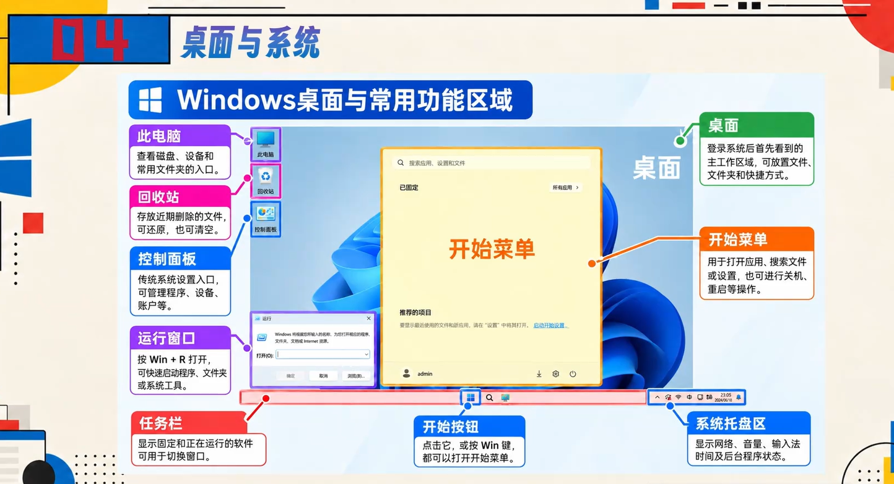
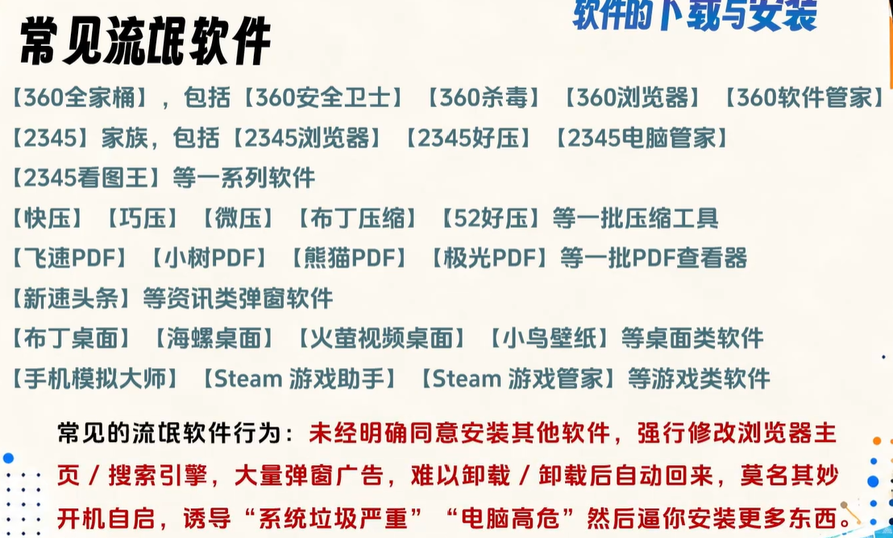
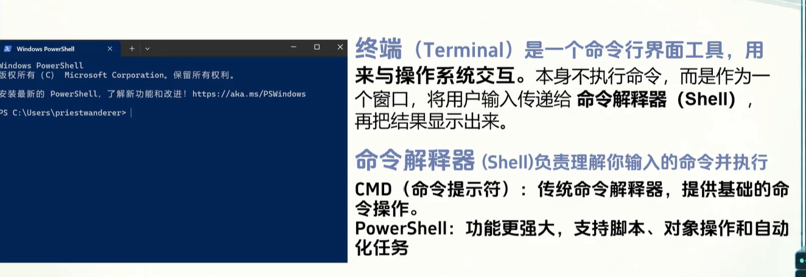

# 计算机基本知识
## 硬件

### 中央处理器（Central Processing Unit，简称CPU）

作为计算机系统的**运算**和**控制**核心，是**信息处理**、**程序运行**的最终执行单元。  

- #### 主要架构
x86架构、ARM架构

- #### CPU的工作阶段：  
取指令阶段、指令译码阶段、执行指令阶段、访存取数和结果写回。

### 图形处理器（Graphics Processing Unit，GPU）

又称**显示核心（display core）**，**显示芯片（display chip）**，**视觉处理器（video processor）**，是一种用于处理图像和图形运算工作的协处理器

商用GPU主要包括NVIDIA Geforce系列、AMD Radeon系列和 NVIDIA Tesla系列等，它们在图像处理等应用领域提供了高逼真的渲染效果，在科学计算等研究领域提供了强大的计算能力

### 随机存取存储器（Random Access Memory，RAM）

也叫**主存/内存**，是与CPU**直接交换数据**的内部存储器。它可以随时读写（刷新时除外），而且速度很快，通常作为操作系统或其他正在运行中的程序的临时数据存储介质。 

存储器是数字系统中用以存储大量信息的设备或部件，是计算机和数字设备中的重要组成部分。存储器可分为 **随机存取存储器（RAM）** 和 **只读存储器（ROM）** 两大类。  

- 随机存取存储器（RAM）既可向指定单元存入信息又可从指定单元读出信息。任何RAM中存储的信息在断电后均会丢失，所以RAM是易失性存储器。  

- ROM为只读存储器，除了固定存储数据、表格、固化程序外，在组合逻辑电路中也有着广泛用途。

- RAM与ROM的最大区别是数据的**易失性**，即一旦断电所存储的数据将随之丢失。RAM在计算机和数字系统中用来暂时存储程序、数据和中间结果。
- 决定你的电脑可以同时运行多少程序

### 固态硬盘（Solid State Drive/Disk，SSD）

是一种使用**非易失性半导体存储介质**保存数据的**存储设备**，常见产品主要采用NAND闪存，并由控制器负责数据映射、纠错和主机接口管理。其内部不使用机械旋转盘片和磁头

- 长期保留数据、软件、文件，关机后内容仍然存在
- 类似仓库，决定电脑放多少东西

### 机械硬盘（Hard Disk Drive，HDD）

是以磁性盘片为存储介质的传统数据存储设备，由盘片、磁头、主轴电机、磁头臂及控制电路等部件组成。盘片表面覆盖磁性涂层，通过磁头在高速旋转盘片上的精确定位实现数据读写，盘片转速多为5400/7200 RPM，寻道时间与旋转延迟影响其读写性能

>内存 **≠** 存储  

>手机32GB 一般为内存，而512GB/1T 为存储

### 主板
作为连接平台联系着各硬件

### 电源
给各硬件供电
>使用的**电源适配器≠充电器**，是专门用于给电脑供电的，可以防止电池损耗

### 输入设备
将外部信息输入计算机，eg.键盘、鼠标

### 输出设备
将计算机结算结果输出，eg.显示器、音响

## 软件

### 系统软件（System Software）

直接作用于硬件

>操作系统

举例：Windows、Linux、macOS、鸿蒙

解释：电脑开机后运行的最基础平台。它负责管理所有的硬件（比如决定哪个软件用多少内存、怎么显示画面），同时也为应用软件提供运行环境。没有它，其他软件都无法运行。

>语言处理程序（c++编译器、Python解释器）

举例：C++ 编译器、Python 解释器。

解释：电脑的 CPU 只能听懂“0和1”组成的机器码。程序员用 C++ 或 Python 这种人类能看懂的语言写了代码，必须靠“语言处理程序”把它翻译成机器码，电脑才能执行。

>系统工具软件：维护系统稳定、保障硬件与软件安全

举例：磁盘清理工具、杀毒软件、系统备份工具等。

解释：它们负责日常维护。比如帮你清理系统垃圾、修复漏洞、查杀病毒、保障系统安全稳定运行。它们一般属于操作系统自带的功能，或者由第三方提供。

### 应用软件
>办公软件（处理文档和数据）

代表：Word、Excel、PowerPoint。

作用：写报告、做表格、弄幻灯片，是打工人和学生的基本生产力工具

>图像处理软件（视觉创作）

代表：Photoshop (Ps)、Illustrator (Ai)。

作用：修图、抠图、海报设计、画插画。

>通信软件（与人沟通）

代表：微信、QQ。

作用：日常聊天、发文件、打语音视频电话，连接人与人。

>工业上的工程控制软件（专业领域）

代表：AutoCAD（画工程图）、各类工厂机床控制软件、医疗仪器配套软件。

作用：这类软件通常极其专业，用于特定行业的生产、设计和控制。

>各类娱乐、游戏软件（放松身心）

代表：Steam、各种电脑游戏、视频播放器、音乐软件。

作用：满足休闲娱乐需求。

### 点了图标后what happen

1. 你双击程序
2. SSD/硬盘  
系统去硬盘中找到该软件的源代码（.exe文件）
3. Windows   
操作系统先评估该软件需要多少内存，并在后台准备好运行环境、分配所需空间
4. RAM/内存  
把需要的数据加载进来 

    硬盘虽然能存东西，但读取速度太慢。Windows 会把刚从硬盘里找到的软件代码，以及软件运行需要的临时数据，全部搬运到内存里。因为内存速度极快，CPU 可以直接从这里拿数据。
5. CPU   
飞速读取内存里的代码指令，开始执行程序指令
6. GPU  
若涉及图形界面，负责部分图形计算（画面渲染）
7. 显示器  
看到窗口被打开

## 桌面与系统

>桌面图标是快捷方式，若想卸载得

### 文件资源管理器（File Explorer）

作用：浏览、管理电脑上的磁盘、文件、文件夹  

快捷键：Win+E

### 此电脑（This PC）
作用：显示电脑中的磁盘、设备和文件夹，快速进入常用目录，查看硬盘空间

### 任务管理器（Task Manager）
- 作用：
  1. 查看当前运行的程序和后台进程
  2. 检查CPU、内存、磁盘、网络的使用情况
  3. 结束无响应的程序（卡死时）  

- 打开方式：  
  1. Ctrl + Shift + Esc
  2. Ctrl + Alt + Delete 选择任务管理器
  3. 右键开始按钮，选择“任务管理器”

## 文件、路径与目录
### 文件（File）
- 定义：存储和管理数据的基本单位。

- 表现形式：文字、图片、音频、视频、程序、代码等，最终都可以以文件的形式存储。

- 常见类型举例：

  .exe：可执行程序（如：红警.exe）  
  .cpp：代码文件（如：Hello.cpp）  
  .mp4：视频文件（如：演示视频.mp4）  
  .xlsx：表格文件（如：列表.xlsx）
  .png：图片文件（如：照片.png）

### 文件夹 (Folder) / 目录 (Directory)
- 目录 (Directory)：文件系统中用于组织文件和其他目录的结构（偏底层和技术概念）。

- 文件夹 (Folder)：图形界面对“目录”的直观表现（图标形式）。

- 路径示例：

  文本路径表示：E:\Projects\Homework\Math

  图形界面表现（资源管理器）：  
  文件夹的包含

### 文件名的组成与常见扩展名
#### 文件名字的组成
基本结构：文件名 + . + 扩展名 （例如：steam.exe）

#### 各部分的作用：

>文件名：帮助用户快速识别和找到文件（如上面的 steam）。

>扩展名：通常用于标识文件的类型（如上面的 .exe）。

>系统关联机制：Windows 系统会根据扩展名（文件关联）自动选择相应的程序来打开文件。

.docx → 默认用 Word 打开。

.xlsx → 默认用 Excel 打开。

.png → 默认用图片查看器打开。

.exe → 作为可执行程序直接运行。

#### 常见扩展名分类速查
- 文档与文本

  .txt：纯文本文件

  .doc / .docx：Word 文档

  .xls / .xlsx：Excel 表格

  .ppt / .pptx：演示文稿（幻灯片）

- 多媒体文件

  .jpg / .png / .gif：图片

  .mp3 / .wav：音频

  .mp4 / .avi：视频

- 程序与代码

  .exe：可执行程序（Windows 系统）

  .apk：安卓安装包（Android 系统）

  .c / .cpp / .py / .java：源代码文件

- 压缩包

  .zip / .rar / .7z：压缩文件

### 文件命名规范注意点
>⚠️ 注意：在编程、写代码或进行专业文件管理时，务必遵守以下命名规则。

推荐命名组合：最好使用「英文 + 数字 + 下划线 _」。

示例：hello_1.cpp

❌ 禁止使用的元素：

不要使用数字开头。

不要使用空格。

不要使用特殊字符（如 #、%、* 等）。

⚠️ 代码文件特别提醒：

编写代码的文件，最好绝对不要使用中文命名，否则**在编译或运行环境（如命令行、Linux 系统）中极易报错**。

>仅更改扩展名无法改变文件格式，需使用专门的软件转换文件格式，否则报错。（因为只是改了标签，内部编码没有改变）

## 软件的下载与卸载

### 下载

>软件优先在官网下载，可以分盘  

>镜像站：
> - 加速访问：如果原服务器在国外，直接访问可能很慢。镜像站相当于在离你更近的地方放了一份拷贝，能大幅提升下载和浏览速度。  
>- 分担流量：当很多人同时访问一个网站（比如下载大型软件）时，多个镜像站可以一起分担压力，防止原站崩溃。  
>- 备份与容灾：如果原网站服务器出故障或数据丢失，镜像站可以作为一个完整的备份，保证信息依然能访问。

>⚠️网上也存在一些非官方的镜像站，下载文件时最好还是认准知名高校或大公司维护的站点，安全更有保障。

### 下载后安装

安装路径：**不要随便安装在C盘**，可以给应用软件单独划分一个磁盘/文件夹

C盘是装系统软件的，容易爆红。

### word
>快捷键 ctrl + z 撤销
>shift + enter 分页
>名字的对齐可以考虑用“表格”

## 命令行与环境变量

### 图形界面（GUI - Graphical User Interface）
直观表现：通过图标、文件夹、菜单和鼠标点击来操作（如 Windows 文件资源管理器）。

用户看到什么就点什么，门槛极低，适合绝大多数日常操作。

### 命令行（CLI - Command Line Interface）
直观表现：通过纯文本的黑底白字窗口（如 Windows PowerShell、CMD），输入代码指令来操作。

用户需要记住特定的命令语法，让电脑执行精确的批量任务或底层操作。

>win + R 调出运行窗口，再输入cmd，调出命令行

#### 为什么要了解命令行 (CLI)？
1. 很多软件和工具依赖命令行  

   很多专业工具没有图形界面，只能在命令行中运行。

   开发工具：编译器、包管理器（如 npm、pip）。

   系统与协作：服务器管理、版本控制工具（如 git）。

   网络调试：网络诊断工具（如 ping、tracert 等）。

2. 命令行简化操作流程（更高效）
   批量操作：GUI 需要鼠标逐个点选；CLI 结合目录规则即可完成大规模、批量的操作。

   便捷远程：GUI 远程控制往往依赖复杂笨重的软件；CLI 只需要一行 ssh 命令即可轻松远程连接。

3. 命令行更轻量化（更省资源）  

   GUI 的缺点：图形界面程序需要加载窗口、图标、动画等，比较占用内存资源。

   CLI 的优势：只处理文字和逻辑，运行极其轻巧，特别适合在资源有限的环境（如云服务器、老旧电脑）中使用。