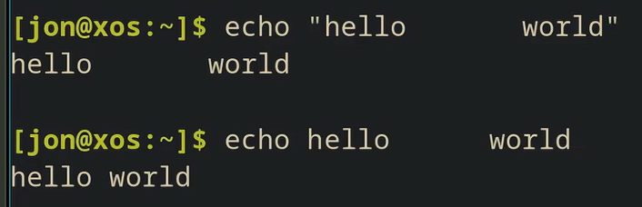
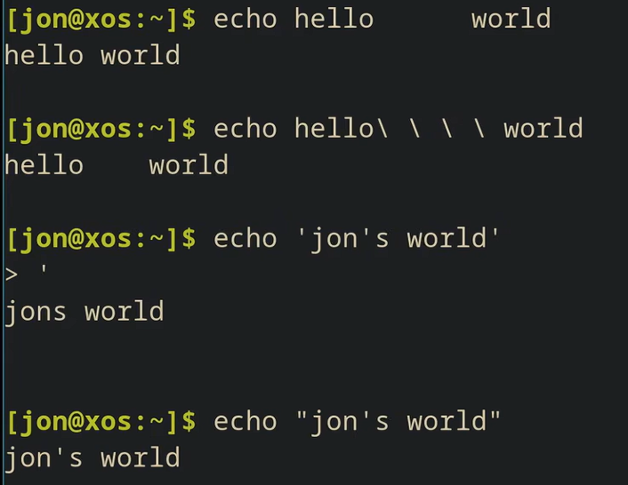

# 计算机缺失的一门课

- UI = User Interface ,用户界面---人与计算机系统交互的媒介，包括屏幕上的按钮、菜单、图标、布局等视觉和交互元素。
- cmd 与 power shell  
1.**CMD**：老式命令行，处理纯文本。只能做基本的文件操作和简单脚本。  
2.**power shell**：现代命令行，处理.NET对象，功能强大，支持复杂脚本、自动化管理和远程操作，是系统管理员的首选

## Linux系统下的终端
1. **echo** 原样输出echo后的内容   
eg.echo hello 会输出hello 
  
  
2. **man** man为manual(手册)的缩写，可用于查询系统中任意命令的详细说明  
eg. man date 会打开date程序说明  
3. **cd** cd即change directory,切换目录。  
此外，Shell通常带有自动补全功能Tab键。  
eg. cd /bin 来到bin目录中  
> .可替代当前目录，..可替代上一级目录  
eg.cd ..回到上一级目录
4. **pwd** print working directory,打印当前工作目录
