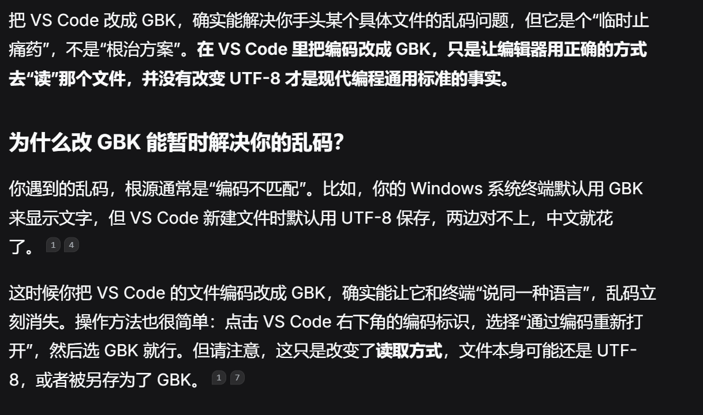
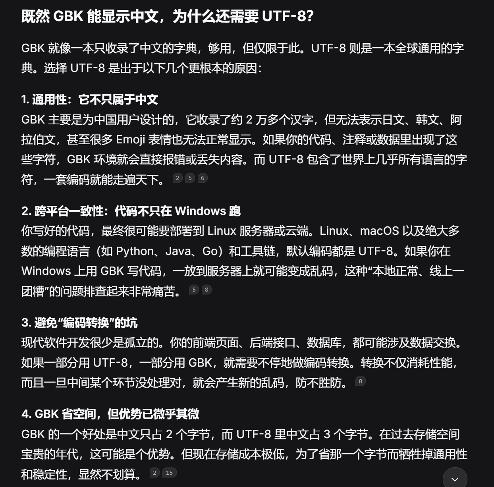
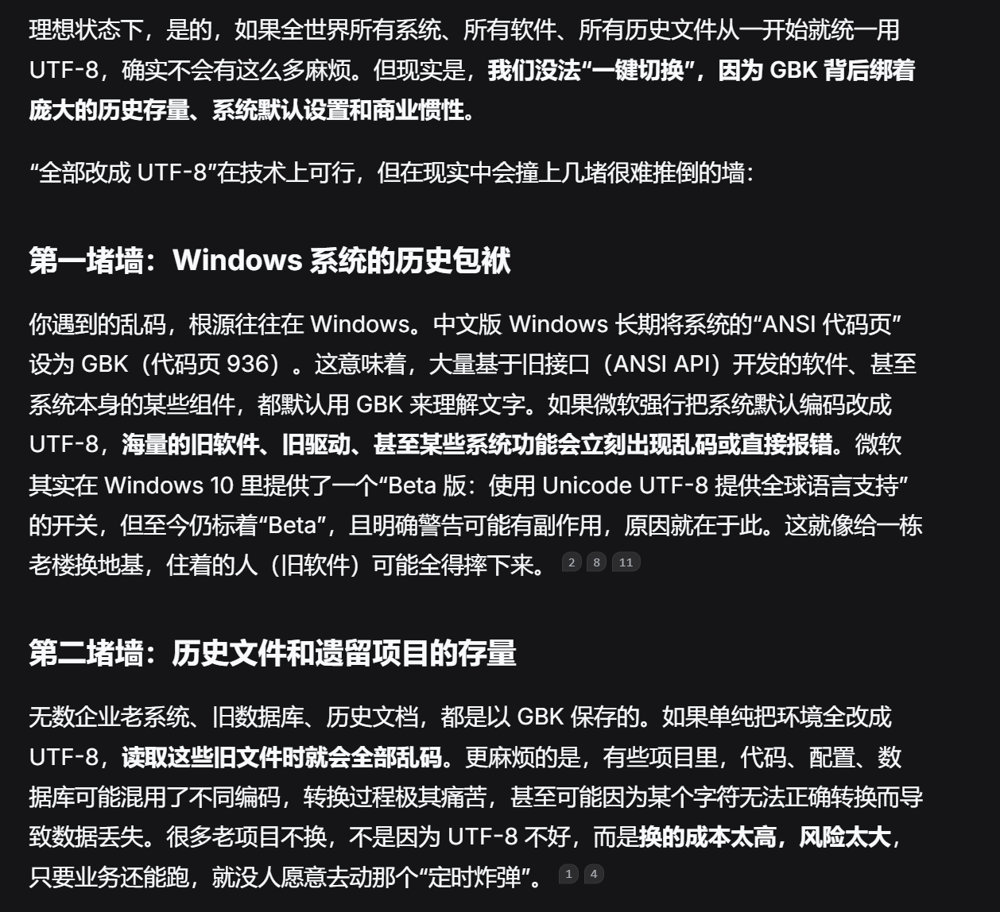
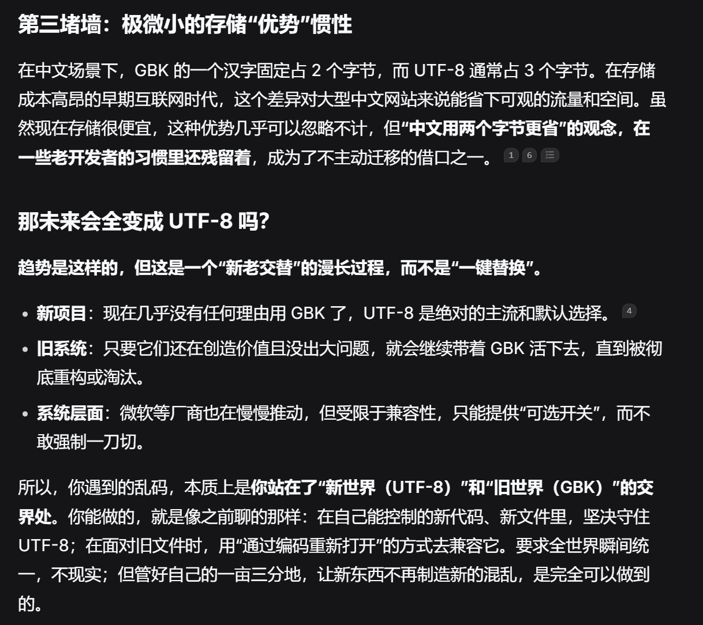

# 披荆斩棘
特设此文档来记录学习过程中所遇到过的所有挫折/报错/冲突。

### 2026.11.11 合并冲突

本地代码与GitHub 远程仓库的代码发生了“冲突”，Git 无法自动合并，手动选择保留内容即可。

### 乱码问题
>我最近遇到了编码的问题（也就是程序中文乱码），我在想，是不是把vscode转换成GBK就可以了？既然GBK也可以输入/输出中文，为什么还需要UTF-8呢   

  

>那既然UTF-8这么好，为什么不全部都改成UTF-8，不要GBK呢？  

